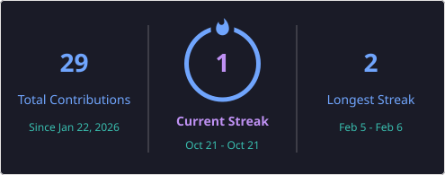

# Hi, I'm Sarthak Dubey! 👋

Software Engineer focused on building full-stack web applications, real-time backend systems, and clean developer tooling. Currently diving deep into core JavaScript internals, modern TypeScript architectures, and distributed state.

---

### 🛠️ Tech Stack & Tooling

**Languages & Frameworks:**  
`TypeScript` `JavaScript (ES6+)` `Next.js` `React` `Node.js` `Express` `HTML5` `Tailwind CSS`

**Databases & Infrastructure:**  
`PostgreSQL` `Redis` `Prisma` `Docker` `Git` `Linux` `Firebase`

---

### 📌 Current Focus & Proof-of-Work

- 🔭 **Building:** High-concurrency event pipelines and real-time WebSocket tools.
- 📚 **Deep Diving:** Relational database optimization, indexing strategies, and asynchronous Node.js runtimes.
- 🎯 **Milestones:** Transitioning from rapid prototyping to production-grade system architectures.

---

### 🔥 GitHub Streak

  

---

### 📬 Connect With Me

- **Twitter / X:** [@mesarthakdubey](https://x.com/mesarthakdubey)
- **LinkedIn:** [linkedin.com/in/sarthakdubey-dev](https://linkedin.com/in/sarthakdubey-dev)
- **Substack:** [substack.com/@devsarthak](https://substack.com/@devsarthak)
